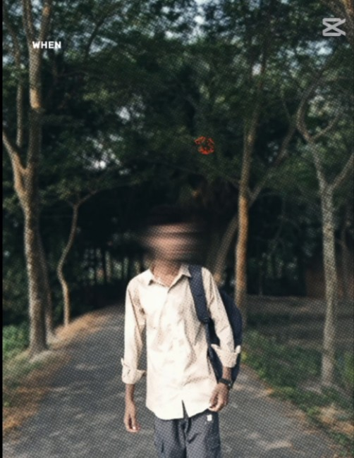

<div align="center">


[](https://github.com/kgf-cyber-123)
[](https://github.com/kgf-cyber-123)
[](https://python.org)
[](https://termux.dev)

</div>

---

### 💻 ᴛᴀʀɢᴇᴛ ᴘʀᴏꜰɪʟᴇ // ꜱʏꜱᴛᴇᴍ ᴏᴠᴇʀᴠɪᴇᴡ

```bash
┌──(kalyan@kgf-terminal)-[~]
└─$ whoami
Kalyan King - Commander of KGF Cyber Team. 
Specialized in Python automation, API exploitation, Termux scripting, Telegram bot architecture, and advanced threat intelligence research. Operating strictly from the terminal shadows.
📸 ᴏᴘᴇʀᴀᴛɪᴏɴᴀʟ ɪɴᴛᴇʟ // ꜱᴄʀᴇᴇɴꜱʜᴏᴛ
​<div align="center">

</div>
​🛠️ 30+ ᴇxᴘʟᴏɪᴛꜱ, ᴛᴏᴏʟꜱ & ᴛᴇᴄʜ ꜱᴛᴀᴄᴋ
​<p align="center">

</p>
​📊 ɢɪᴛʜᴜʙ ꜱᴛᴀᴛꜱ & ᴍᴇᴛʀɪᴄꜱ
​<div align="center">


</div>
​<div align="center">

</div>
​🏆 ɢɪᴛʜᴜʙ ᴛʀᴏᴘʜɪᴇꜱ & ᴀᴄʜɪᴇᴠᴇᴍᴇɴᴛꜱ
​<p align="center">

</p>
​🌐 ꜱᴇᴄᴜʀᴇ ᴄᴏᴍᴍᴜɴɪᴄᴀᴛɪᴏɴꜱ // ᴏꜰꜰɪᴄɪᴀʟ ʟɪɴᴋꜱ
​<p align="center">
<a href="https://www.facebook.com/Kalyanmitro123">

</a>
<a href="https://t.me/KGF_TEAM_BD">

</a>
<a href="https://t.me/KALYAN_KING_Bot">

</a>
<a href="https://github.com/kgf-cyber-123">

</a>
</p>
​⚡ ʀᴀɴᴅᴏᴍ ʜᴀᴄᴋᴇʀ ǫᴜᴏᴛᴇ
​<p align="center">

</p>
​<div align="center">
<h3>🐍 ʟɪᴠᴇ ᴄᴏɴᴛʀɪʙᴜᴛɪᴏɴ ɢʀɪᴅ ᴛʀᴀᴄᴋᴇʀ</h3>

</div>
